<!-- ═══════════════════════════════════════════════════════════════════════ -->
<!--  NÍKO ESCOBAR — GitHub profile README                                    -->
<!--  All portraits & gifs are hosted locally, under /assets.                 -->
<!--                                                                          -->
<!--  STICKER / GIF CREDITS                                                   -->
<!--  • Tech-logo stickers (js, node, vue, react, html, css, svelte, python,  -->
<!--    android, apple, visualstudio) by devRock / Escuela DevRock            -->
<!--        https://giphy.com/devrock                                         -->
<!--  • Animated name letters (N · i · K · O) by SunBoui                       -->
<!--        https://giphy.com/SunBoui                                         -->
<!--  • Cyber-goggles / "激進 (radical)" hero sticker by Radicalzz Studio       -->
<!--        https://giphy.com/radicalzz-studio                                -->
<!--  • Pixel rainbow heart by Codecademy                                     -->
<!--        https://giphy.com/Codecademy                                      -->
<!--  • Unity engine logo by Unity Technologies                               -->
<!--        https://giphy.com/unitytechnologies                              -->
<!--  Sourced from Giphy and vendored locally so nothing hotlinks offsite.    -->
<!--                                                                          -->
<!--  WAVE FRAME  (assets/wave-top.svg, assets/wave-bottom.svg)               -->
<!--  Self-made animated SVGs — the local, no-external-URL equivalent of the  -->
<!--  capsule-render.vercel.app "waving" banners. SMIL animation runs inside  -->
<!--  an -referenced SVG on GitHub, so no service call is needed.        -->
<!--  SKILL ICONS  (assets/skills/skills-*.svg)                                -->
<!--  Static SVGs from skillicons.dev, downloaded & vendored locally,         -->
<!--  split into category rows (languages / frameworks / cloud / tools).      -->
<!-- ═══════════════════════════════════════════════════════════════════════ -->

<!-- Local animated razor (top frame) — no external URL -->

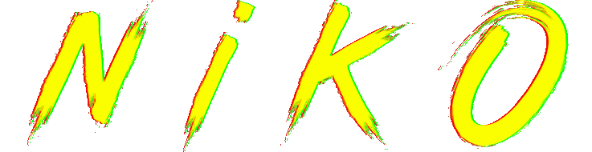

<!-- Cyber-goggles hero sticker by Radicalzz Studio (see credits above) -->
 
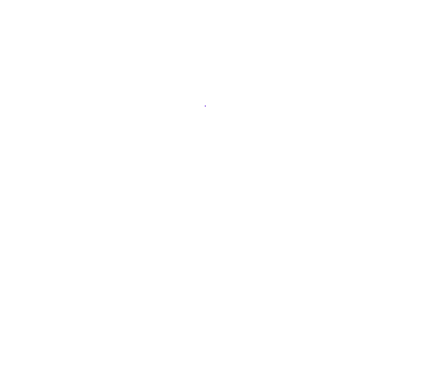

**Full-stack developer.** *I wasn't replaced by AI. I was validated by it.*
<!-- Built faster before AI made everyone look faster. -->

<!-- Local animated neon divider -->


## Neural Upgrades

*Continuous learning is my legacy code.*

  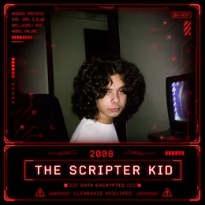
  &nbsp;
  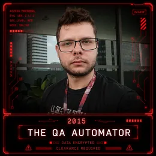
  &nbsp;
  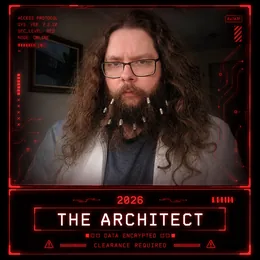
  &nbsp;
  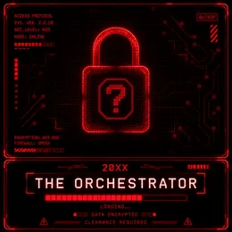

<!-- Local animated neon divider -->

## Installed Modules

<!-- Tech-logo stickers by devRock / Escuela DevRock (see credits at top) -->
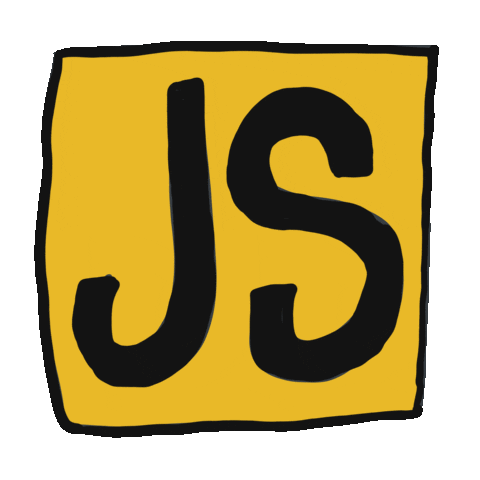&nbsp;&nbsp;
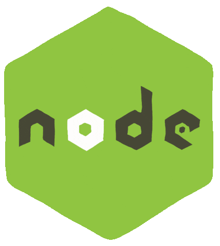&nbsp;&nbsp;
&nbsp;&nbsp;
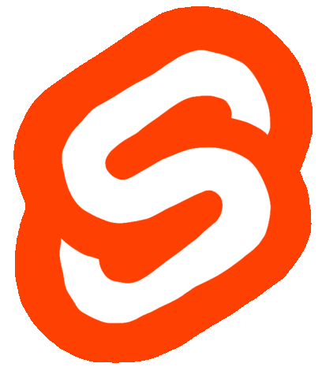&nbsp;&nbsp;
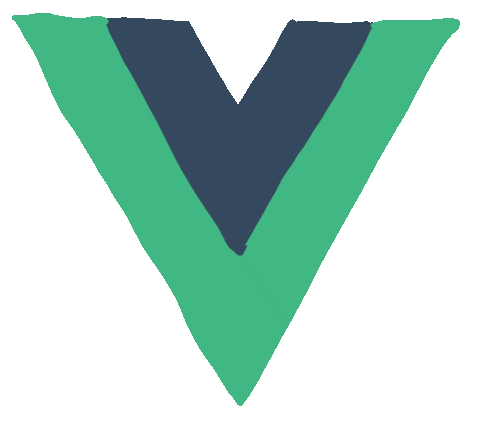&nbsp;&nbsp;
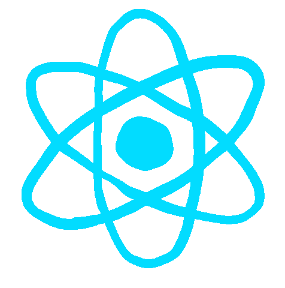&nbsp;&nbsp;
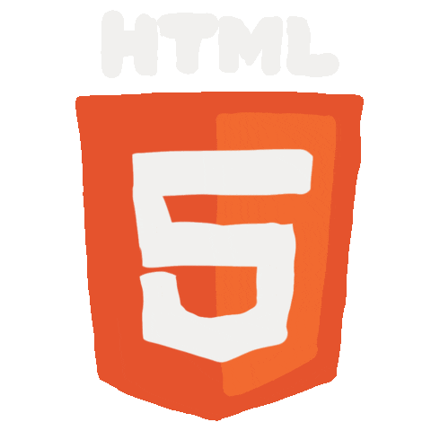&nbsp;&nbsp;
&nbsp;&nbsp;
&nbsp;&nbsp;
&nbsp;&nbsp;
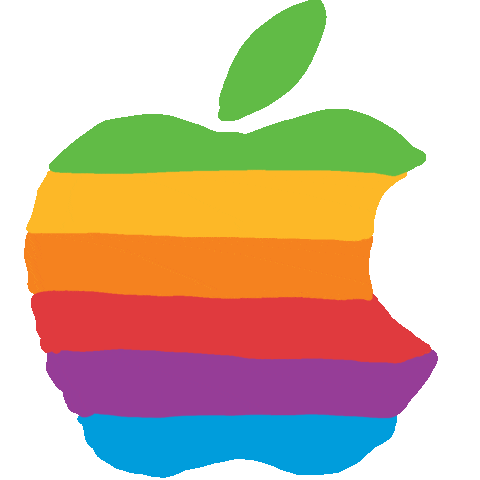&nbsp;&nbsp;
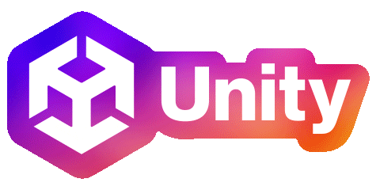

  

<!-- Techs without a gif — static icons from skillicons.dev, vendored locally -->

<!-- Local animated neon divider -->

> *"Any sufficiently seasoned developer is indistinguishable from a wizard. ✨"*

<!-- Pixel heart by Codecademy (see credits above) -->
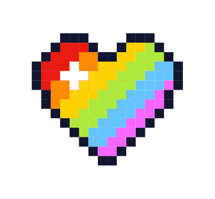

<!-- Local animated razor (bottom frame) — no external URL -->
